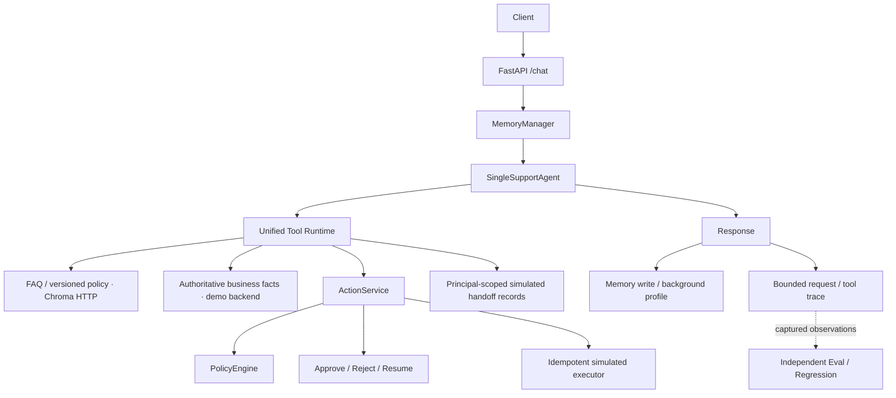

# CartCare

E-commerce Support Agent

CartCare 是面向 FAQ、商品、订单、物流、库存和售后的 **Single Support Agent** 项目。它展示如何把模型的工具选择与确定性业务控制接成可观察、可验证的客服流程。当前使用真实模型、Redis 和外部 Chroma HTTP；商城与动作执行使用明确标注的演示后端。

## What it does

- 回答政策 / FAQ，展示检索来源与版本；不足时保留 low_confidence / no_answer / degraded 状态。
- 通过 Provider 查询订单、物流、商品、库存和退款状态；缺少必要参数时由 Agent 澄清。
- 请求退款或取消订单，由 PolicyEngine 和 ActionService 控制资格、审批、二次校验与幂等。
- 明确要求人工时创建结构化模拟交接记录；返回真实 handoff_id / created 或 failed，而非通过回复关键词判断成功。
- 在 `/demo` 查看最终回答、工具参数与结果、引用、Policy、Pending approval、动作状态和请求耗时。

## Architecture



实际入口：`api/main.py:chat` → `MemoryManager.get_context` → `SupportRuntime.run` → `SingleSupportAgent.handle` → `BaseAgent._call_llm` → `agents/tools.py` / `core/tool_contract.py`。最多 3 轮 Tool Calling；随后写回 Memory、调度画像更新、返回回答与引用。RAG 由 Agent 按需选择，不是每次请求的前置固定阶段。Eval 独立触发，不在每次 `/chat` 中运行。

## Key engineering decisions

- **单 Agent + 工具**：当前电商 workload 未证明多 Agent 协作收益。T10 对比支持简化，生产入口不再经过 Intent / specialist dispatch / supporting Agent / Composer。旧 Multi 仅保留为历史实验。
- **知识与事实分离**：政策解释来自 RAG；订单、库存和物流必须重新查 Provider，不能从检索文本或历史回复推断当前状态。
- **统一工具边界**：严格 schema、read / write / dangerous 风险、typed errors、timeout / retry 元数据。仅幂等读工具自动重试可重试错误；危险动作由 ActionService 控制。
- **可观察而不暴露隐藏推理**：Trace 展示已执行的工具、校验输入、结果摘要与错误，并按步记录每次模型调用的 token、延迟、选择的工具、参数摘要和停止原因；不保存隐藏 chain-of-thought 或原始 Memory 内容。`mcp/` 是自研本地工具层，尚非标准 MCP SDK / transport 接入。

## End-to-end examples

| 场景 | 用户输入 | 应观察的执行证据 |
|---|---|---|
| FAQ / policy | 退款政策是什么？ | search_knowledge_base → retrieval_status → citation / source / 文档标题 / policy_version |
| Order lookup | 查询我的订单 ORD-T09-ORDER | get_order → validated_input → Provider 结果；Memory 不替代最新查询 |
| Refund approval | 为 ORD-T09-REFUND-APPROVAL 提交 600 元部分退款 | request_refund → require_approval → awaiting_approval；点击 Approve / Reject 查看 ActionResult |

这些是演示输入与观察目标，模型输出和实际工具调用不预设成功。Trace 中没有 ActionService 结果时，UI 不从回答推定动作已完成。库存缺少 SKU 时应澄清；ownership violation 使用 customer-2 请求 customer-1 的订单；订票等越界请求可合理拒绝，不自动等于需要人工。

结构化交接：`SingleSupportAgent → request_handoff → HandoffService → API/Trace handoff`。明确人工请求由保守确定性门控兜底；复杂电商投诉和已观察到的业务查询依赖故障可由 Agent 请求，服务再次校验策略。`handoff_required/requested/created/failed` 分别记录业务需求、真实创建调用、成功和失败；兼容 `escalated` 仅表示 created。`GET /handoffs/{id}` 只允许 owner 查询。客户端重复提交应复用 `conv_id + handoff_key`；新请求用新 key。没有 key 时只在同一后端请求内去重。创建成功后模型或 Memory 写入失败仍保留回执；摘要工具不建单。进程内模拟记录不等于真人接单，重启/多worker不共享。设计与实现见 `core/handoff.py` 与 `agents/support_agent.py`。

## Safety / business controls

HTTP 先由可替换 AuthAdapter 验证 Principal（subject_id/customer_id/roles），默认拒绝受保护请求。`/chat` 的 user_id 可省略，提供时必须匹配 Principal；服务端将 Principal 与其 customer_id 传入 Tool Context，Provider 检查订单归属，ActionService 再检查身份/权限。任意 X-User-Id、客户端 role 或 body user_id 均不能创建身份。401 表示未认证，403 表示权限不足；跨客户 Action 查询隐藏为404。

需要人工审核的动作仅可由独立 reviewer 批准，且 owner 必须在其服务端 `review_customers` 范围；同 customer_id 或同请求主体禁止自审。动作保留 owner、requested_by 和 reviewed_by，重复审批仍单次执行。客户可拒绝自己的待审批请求，不能批准；admin 不自动获得 reviewer 权限。

Trace、Knowledge 添加/上传/统计、Skills 查询/reload、Eval、Monitor、Metrics 和诊断 Search 要求 admin。`/eval/run` 每轮通过独立模拟 Runtime/BusinessState/ActionStore 执行，内部使用固定 customer-1 测试 Principal，保留 Policy/HITL；不接入聊天 Memory。隔离实现见 `evaluation/runtime.py`。静态 Demo 与 health 仍公开；没有生产认证验证器时不会自动降级为Demo/anonymous。

受控本地 Demo Auth 需同时配置 `CARTCARE_AUTH_MODE=demo`、`APP_ENV=development`、`API_HOST=127.0.0.1`（或 ::1）、回环客户端/Host及 `CARTCARE_DEMO_CREDENTIALS` 服务端JSON映射。凭据键为自行生成、至少32字符的Bearer token；值为 `{"subject_id":"...","customer_id":"customer-1","roles":["customer"]}`，reviewer另设roles及review_customers列表，admin另设roles。没有默认凭据。Demo页面分开输入customer/reviewer/admin token，不保存至浏览器存储；user_id仍须与客户凭据一致。CLI 使用 `CARTCARE_CLI_TOKEN`。不要把Demo暴露到公网或公共反向代理；它不替代生产认证、凭据生命周期与部署安全审查。真实验证器通过 `app.state.auth_adapter` 或 FastAPI `get_auth_adapter` 依赖安装。设计与限制见 `core/auth.py` 及本节说明。

`request_refund` / `request_cancel_order` → ActionService → PolicyEngine → deny / allow / require_approval → HITL（需要时）→ Executor。审批、恢复、执行时再次校验和幂等都在后端实现。UI 只消费 `/actions/{id}/approve`、`reject`、`resume` 和 GET `/actions/{id}`；现有 Approve API 可能直接完成执行，Resume 不能绕过审批。

模拟退款执行完成后，Action 为 `completed`，订单为 `refund_pending`，退款查询返回新建的 `RefundRecord.status=pending`，表示等待后续处理，不能据此声称资金到账。执行回执追加 `refund_id` / `refund_status`，查询 Tool 沿用原字段并新增可返回状态 `pending`；按订单查询选择最新 updated_at 的记录，旧记录仍可按退款编号查询。startup 的读写 Backend 显式共享进程内状态和锁；不保证重启或多进程一致性。实现见 `actions/backend.py` 与 `providers/mock_backend.py`。

## RAG

知识文档要求 source / document_id / doc_type；政策还要求 policy_version / effective_at。同 document_id/version 修订会完整替换旧片段；跨版本替代必须显式声明 `supersedes`（同文档前驱版本），并受 `effective_at` / 可选 `expires_at` / `publication_status=active|revoked` 约束。新 citation 增加 content_hash，reference 附实际 chunk hash。发布失败返回固定 503，不把部分写入作为成功；Chroma 非事务、逐文档发布。旧无发布记录数据不作为当前依据，需从可信源审核重发布，不能自动按版本字符串迁移。详细接口与恢复逻辑见 `mcp/knowledge_base.py`。外部 Chroma Server 是唯一存储路径，连接失败不会切换到嵌入式数据库。字符 n-gram lexical embedding 是演示基线，`1 - Chroma distance` 的 0.35 阈值仍待更广泛校准。

只有 `usable` 命中可展示可靠 citation；正常 `no_answer` / `low_confidence` 的检索调用可 `success=true`，但 results/citations 为空；调用成功不等于有可用知识。`reranked` 仅表示模型完成有效排序，新增 `rerank_status` 区分跳过与 fallback。空/异常排序按完整排序契约整体拒绝，原序 fallback 必须经过最终证据及 N06 版本复核；排序契约见 `mcp/rag_contract.py`。`low_confidence`、`no_answer`、`degraded` 和未检索分别显示。引用证明检索来源，不等于逐句事实核验。文档标题通过 Trace 的 retrieval_hits 关联 citation，未观测时明确标示。改写、重排、熔断和 fallback 留在现有 RAG 层；KnowledgeBase 命中禁用结果缓存并在重排后复核当前版本，普通工具缓存保留。

## Memory

Redis 工作记忆按用户 / 会话隔离，TTL 24 小时；15 条触发确定性压缩，保留最近 5 条及订单引用、待澄清字段。Chroma 长期记录仅保留带来源、归属、有效期的咨询主题（30 天）与明确回复偏好（180 天）。动态订单、物流、库存和退款状态不保存为长期事实。

Trace 展示读取计数、摘要是否存在、读写状态与耗时，不记录原始 Memory 内容。后台画像仅标记 `scheduled_unobserved`，不把调度成功视为落库成功。Redis 读取故障返回明确 503，Agent 不执行；该早期失败不会生成 Agent Trace。

`/chat` 追加 `action_results`（既有 ActionResult 契约）、`memory_write_status` 和 `warning_codes`。危险工具回执须经带 Principal 的 ActionService 查询确认；至少一个动作已 `completed` 且有执行回执时，后续 Memory 写入失败返回 HTTP 200、`memory_write_status=failed`、`warning_codes=["memory_write_failed"]`，保留各动作真实状态和可查询编号。HTTP 200 不代表所有动作成功，更不代表退款到账；客户端以结构化动作状态判断业务结果。没有确认完成动作或已创建交接时，写入异常仍走原 HTTP 500；读取故障仍 fail-closed。失败写入不调度画像，Trace 记录失败角色、成功返回的写入调用数和耗时。实现见 `api/main.py` 的 `/chat` 写入分支。

## Evaluation

[确定性专项 Eval](evaluation/README.md)评分工具参数、业务规则、HITL、RAG 和安全行为；LLM-as-Judge 只用于主观回复质量。历史报告保持原样，Single 的 nullable deprecated routing / intent 字段不用于伪造路由准确率。

A02独立交接数据集：`uv run python -m evaluation.run_handoff_eval`，只运行 Fake SDK 与本地 FastAPI TestClient；以 API状态、Trace、owner可查询记录和后端回执评分。不以回答中的“转人工”评分，不改 T10 历史 `0/3`。

[T10 历史对比](evaluation/reports/t10_topology_comparison.md)：真实模型、演示业务后端，**controlled demo workload，3 × 10 cases / topology，not production benchmark**。

| 指标 | Multi | Single |
|---|---:|---:|
| Task success | 24/30 | 24/30 |
| Avg latency (ms) | 6633.3 | 3937.1 |
| Tool calls | 78 | 59 |
| Model calls | 115 | 76 |

该结果支持当前 workload 的简化选择，不能包装为生产 SLA，也未验证真实协作任务的收益。延迟是实验 runner 耗时；模型次数为 SDK create 调用，不含内部 HTTP retry。

[T11 real-memory acceptance](evaluation/reports/t11_memory_acceptance.md)：演示环境实际 HTTP、模型、Redis / Chroma，**18/18**，包含跨轮订单号沿用、动态 Provider 状态刷新、异步偏好落库、隔离和 Redis 故障关闭。它不是生产规模或长期稳定性测试。

[Single HTTP 回归](evaluation/reports/support_production/regression.md)：1 × 10 演示案例、固定空 Memory adapter，task success 8/10，安全违规 0；unsupported 升级与 ownership 严格任务证据仍有缺口。这不替代真实 Memory 验收。

## Demo

服务启动后打开 [Live Demo](http://localhost:8000/demo)。无需前端构建或新框架，静态资源由同一 FastAPI 提供。

十个一键填入场景：FAQ / policy、order lookup、logistics lookup、inventory clarification、refund allow、refund require approval、refund deny、cancel、ownership violation、unsupported request。选择场景会新建会话；普通连续输入沿用 conv_id。切换 demo user_id 会清空会话号。

使用步骤：

1. 按下文生成当天新鲜业务 fixture，并在启动前设置 `CARTCARE_BUSINESS_FIXTURE`。
2. 选择场景、点击发送，查看最终回答、RAG 卡片、工具风险和校验参数。
3. 对 Pending approval 点击 Approve / Reject / Resume；Refresh 获取当前 ActionResult。卡片绑定原始请求的 demo identity，原始 Trace 快照不被覆盖。
4. 复制 request_id 到 `/trace/tool/{request_id}` 检查执行证据。`/trace/tools` 查看最近记录，`/docs` 查看 API 契约。

`latency_ms` 为 Agent runtime 耗时；Trace 的 `request_latency_ms` 包括 Memory 读取 + Agent + Memory 写入，截止响应序列化前，不含后台画像或浏览器网络时间。

演示执行会改变当前进程内的业务状态。新建会话不会重置业务后端；重复退款 / 取消未必得到首次结果。需要恢复初始场景时重新生成 fixture 并重启 API。过期 fixture 应重新生成，UI 不改变业务规则以维持演示结果。

历史 T12 验证记录（真实模型、Redis/Chroma 与演示动作的 FAQ / Pending approval / Resume / Approve smoke）已归档到本机 `cash/`；它是当时的演示证据，不是当前生产 benchmark。

## Local setup

Python **3.12**，`uv`；依赖来源为 `pyproject.toml` / `uv.lock`。`requirements*.txt` 保留给 Docker / pip 兼容。

以下为 Windows PowerShell 本地 API 路径（项目根目录）：

```powershell
uv sync --dev
# 首次配置 .env，填写 ANTHROPIC_API_KEY / ANTHROPIC_MODEL；可选 ANTHROPIC_BASE_URL
Copy-Item .env.example .env
# 启动外部 Redis / Chroma
docker compose up -d redis chromadb
$env:REDIS_URL = 'redis://:echomind123@localhost:6379/0'
$env:CHROMA_HOST = 'localhost'
$env:CHROMA_PORT = '8001'
$env:PROMETHEUS_PORT = '0' # 本地 Demo 不另开指标监听端口，/metrics 仍可访问
# REDIS_URL 密码需与 Compose 的 REDIS_PASSWORD 一致
uv run python -m demo.prepare
$env:CARTCARE_BUSINESS_FIXTURE = (Resolve-Path data/demo_business_fixture.json).Path
uv run python -m uvicorn api.main:app --host 127.0.0.1 --port 8000
```

已有 `.env` 时保留原配置。知识库首次为空时从 `mcp/knowledge_assets/default_business_v1.json` 加载获批演示资料；先用 `uv run python -m mcp.seed_demo_knowledge --check-assets` 离线核验审批 hash 和 publication revision。普通 seed 与 `--reset` 使用同一资产；非空集合须停写、完整备份，再通过 `--backup-file` 核对未变化快照，优先原位发布。本地演示默认库已完成受控内部维护发布及机械核验；Skills口径修订已通过静态/Fake验证、等待人工验收，业务Answerability和真实/chat仍待独立验证，API保持停止；见 `evaluation/reports/hardening/A05/skills-consistency-20261013/REPORT.md`。执行证据见 `evaluation/reports/hardening/A05/default-kb-internal-publication-20261013T081119Z/REPORT.md`；发布/恢复命令和边界见 `evaluation/reports/hardening/A05/default-kb-publication-20261013/REPORT.md`。保持外部 Chroma 可连接，不使用 PersistentClient fallback。全容器运行仍可用 `docker compose up -d --build`，Compose 的应用服务名 `echomind` 和 `ECHOMIND_*` 兼容标识暂时保留；十场景 fixture 环境变量需传入应用容器，以上本地路径更便于演示。

## Tests

```powershell
uv lock --check
uv run python -m pytest -q -p no:cacheprovider
node --check demo/static/demo.js
node --test tests/demo_ui.test.cjs
git diff --check
```

Node 仅用于静态 UI 语法和渲染 / API 消费契约测试，浏览器使用页面不需 Node。Demo 单元测试使用 fake SDK / Memory / DOM；不能称为真实模型或真实商城集成。原 API 回归覆盖危险 schema、ownership、审批、拒绝、恢复与幂等。真实 Redis / Chroma 可选测试需 `CARTCARE_TEST_LIVE_MEMORY=1`；真实 Chroma RAG 可选测试见 `tests/test_rag_http_integration.py`。

uv 缓存统一位于 `cash/cache/uv`（由 pyproject.toml 配置），pytest 缓存位于 `cash/cache/pytest`。若已有 `UV_CACHE_DIR` 指向旧 `.uv-cache`，请改为 `$env:UV_CACHE_DIR = Join-Path $PWD 'cash/cache/uv'`；显式环境变量优先于项目配置。

## Known limitations

- demo `user_id`，非正式认证；审批 API 仍沿用演示身份模型。
- demo / in-memory commerce Action backend；external commerce / payment API 未接入。
- PendingAction 与审批检查点持久化在 Redis（单实例；多 worker 并发不承诺）；有界 Trace 仍随进程重启丢失，默认只保留最近 200 个请求；模拟业务表仍是内存 fixture。
- character n-gram lexical embedding baseline；阈值、语义召回和更大知识集效果仍需验证。
- unsupported escalation 仍需改进；ownership 严格在线任务证据有缺口，不能混同为确定性安全层未检查。
- long-term expired Chroma records 尚无后台物理清理任务；读取时过滤有效期。
- Trace 的工具结果为业务 / 动作 / 检索摘要及确定性 helper 白名单输出，非完整原始输出；早期 Memory 读失败无 Agent trace，后台画像完成状态未追踪。
- 没有生产 SLA、真实支付成功率、完整客服交接集成或大规模负载证据。

当前核心说明：本 README、[定位与技术亮点](wiki/CartCare定位与技术亮点.md)、[重点代码](wiki/重点代码.md)；执行计划与任务状态见 `CARTCARE_PLAN.md`，协作规则见 `CLAUDE.md`，每轮修改记录见 [变更日志](docs/CHANGELOG.md)。

历史 Workbench、progress JSON、hardening 任务、旧工程说明、T12 记录与截图、旧迁移清单已归档到本机 `cash/archive-20261025/`（不纳入版本库、不进入镜像）。任务证据写入 `docs/reports/`，历史评测报告保留在 `evaluation/reports/`。
