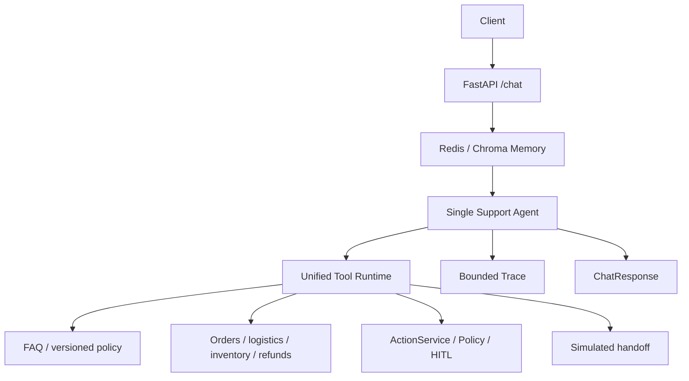

# CartCare

**自研 Agent Harness + 电商客服 Agent**（商城/支付/人工交接为明确标注的模拟后端）

CartCare 把模型的工具选择与确定性业务控制接成一条可观察、可测试、可度量的客服链路：政策问答走 RAG，订单/物流/库存/退款状态必须查 Provider，退款/取消由 Policy、审批和幂等控制，回答不能宣称未执行的动作已经完成。

## 能力地图

### Harness 七层

| 层 | 已实现 |
| --- | --- |
| 工具循环 | 轮次/步数/token 预算、重复调用检测、单步超时、停止原因 |
| 工具契约 | 严格 schema、read/write/dangerous、typed errors、结果截断 |
| 上下文管理 | 每轮上下文构成、预算、工具结果压缩 |
| 状态与中断恢复 | Redis PendingAction/检查点、审批后恢复、四类崩溃窗口 |
| 护栏 | Principal、归属、Policy、审批、输出一致性、幂等 |
| 可观测 | 工具级 Trace、按步 token/延迟/工具/停止原因 |
| 评测框架 | 组件开关、假模型、回放、故障注入、轨迹评分、pass^k、消融 |

### Agent 六项能力

| 能力 | 观察指标 | 证据 |
| --- | --- | --- |
| 选工具、抽参数 | 工具选择/参数准确率 | H1-1、H2-3 |
| 缺信息先澄清 | 澄清率、误执行率 | H1-1、H2-3 |
| 基于证据回答/拒答 | Recall@5、引用正确率、拒答率 | H2-5 |
| 多诉求规划 | 复合任务严格成功率、诉求级完成率 | H3-6 |
| 根据错误纠错 | 故障注入恢复成功率 | H3-2、H3-6 |
| 如实汇报部分成功 | 回答与 ActionResult 一致率 | H3-4、H3-6 |

## 实测结果

> 模型：`deepseek-flash`；演示业务后端 + 真实 Chroma HTTP；不是生产 SLA。完整口径见 [评测结果](docs/evaluation.md)。

### Harness 消融（H3-6，24 条复合用例 × 6 臂）

| Arm | 任务成功率 | 诉求完成率 | 已执行违规 | 故障恢复 |
| --- | ---: | ---: | ---: | ---: |
| full | 11/24 = 45.83% | 35/57 = 61.40% | **0** | 1/3 |
| bare | 13/24 = 54.17% | 38/57 = 66.67% | 0 | 2/3 |
| no_guardrails | 7/24 = 29.17% | 29/57 = 50.88% | **4** | 1/3 |
| no_error_feedback | 11/24 = 45.83% | 38/57 = 66.67% | 0 | 1/3 |
| no_context_compression | 9/24 = 37.50% | 31/57 = 54.39% | 0 | 1/3 |
| no_loop_control | 13/24 = 54.17% | 40/57 = 70.18% | 0 | 2/3 |

护栏是最明确的组件信号：关闭 `policy_guard` + `output_consistency` 后出现 4 个已执行越权完成，full 为 0。其他臂的少量差异在 24 条样本的噪声范围内，不据此改生产默认。

### 单 Agent 评测

| 证据 | 结果 | 说明 |
| --- | ---: | --- |
| H2-3 全量 180 | **143/180 = 79.44%** | 真实模型单轮；p50/p95 6,968/10,328 ms；2 次 forbidden attempt，0 已执行 |
| H2-4 裸基线 | **138/180 = 76.67%** | 保留 Policy、关闭其余 harness；executed violations 0，overclaim 1 |
| H2-5 B0-calibrated | Recall@5 **9/21**，FPR **8/9** | 生产默认词法基线 |
| H2-5 semantic / hybrid | Recall@5 **7/21**，FPR **3/9**，引用精度 70% | 候选 Recall 21/21；语义未赢 Recall，生产未切换 |

H2-3 的 180 条逐 check 安全/工具指标因首段中断不可完整恢复；H2-4 的 ownership 差异（9/16 vs 16/16）是主要机制差异，其他类别 1–3 条波动可能只是噪声。H2-5 的 semantic/hybrid 优势在低误报和引用精度，不在召回；不能写成“语义检索更好”。

## Demo

启动后打开 <http://localhost:8000/demo>。页面消费真实 `/chat`、Trace 和 ActionService API；不补造工具结果或审批逻辑。

> Demo 视频：待录制（H5-3 完成后补充链接）。

可直接观察：政策问答与 citation、订单/物流查询、库存澄清、退款允许/需审批/拒绝、取消、越权拦截、转人工；Pending approval 可 Approve / Reject / Resume。

## 快速开始

### Docker（Linux/macOS）

```bash
cp .env.example .env
# 编辑 .env：至少填写 ANTHROPIC_API_KEY
docker compose up -d --build
curl -fsS http://127.0.0.1:8000/ready
```

打开 <http://localhost:8000/demo>。`/health` 只表示进程存活；`/ready` 检查 Redis/Chroma，不调用模型。

本地 `uv`、PowerShell、Demo Auth、知识库初始化和备份步骤见 [运行与部署](docs/operations.md)。旧 `echomind-*` 容器迁移见 [命名迁移](docs/naming.md)。

## 架构



实际入口：`api/main.py:chat` → `MemoryManager.get_context` → `SupportRuntime.run` → `SingleSupportAgent.handle` → `BaseAgent._call_llm` → `agents/tools.py` / `core/tool_contract.py`。最多 3 轮 Tool Calling；RAG 由 Agent 按需选择，不是每次请求的前置阶段。

关键边界：动态事实只来自 Provider；政策知识只来自 RAG；危险动作必须经过 ActionService/Policy/审批；Trace 记录执行证据，不保存隐藏推理或原始 Memory。详细说明见 [架构与边界](docs/architecture.md) 和 [重点代码](wiki/重点代码.md)。

## 已知限制

- Demo 身份与模拟商城/支付/交接后端，不是生产认证或真实外部集成。
- PendingAction/检查点持久化在 Redis，但单实例；多 worker 并发不承诺。模拟业务表仍是内存 fixture。
- 生产检索仍是字符 n-gram 词法基线；语义实验未切换，阈值和泛化仍需更大数据验证。
- Trace 是进程内有界队列，重启丢失；工具结果是摘要，不是完整原始输出。
- 没有生产 SLA、真实支付成功率、完整客服交接集成或大规模负载证据。

完整列表和适用范围见 [已知限制](docs/limitations.md)。

## 文档

| 文档 | 内容 |
| --- | --- |
| [架构与边界](docs/architecture.md) | 请求路径、Harness 七层、Agent 六项能力、RAG/Provider、审批与恢复 |
| [评测结果](docs/evaluation.md) | H2-3/H2-4/H2-5/H3-6 指标、T10/T11 历史、证据层级 |
| [运行与部署](docs/operations.md) | Docker/本地启动、环境变量、Demo Auth、健康检查、知识库、测试 |
| [已知限制](docs/limitations.md) | 单实例、模拟后端、检索、Memory、可观测、评测口径 |
| [命名迁移](docs/naming.md) | `CARTCARE_*` / 旧 `ECHOMIND_*`、容器/网络/镜像迁移 |
| [重点代码](wiki/重点代码.md) | 可执行调用路径和核心模块职责 |
| [任务证据](docs/reports/) | 每个任务的实现、测试与限制 |
| [变更日志](docs/CHANGELOG.md) | 每轮改动与验证结果 |

项目计划与任务状态见 `CARTCARE_PLAN.md`；协作规则见 `CLAUDE.md`。历史评测报告保留在 `evaluation/reports/`，本地归档不属于公共仓库运行时依赖。
